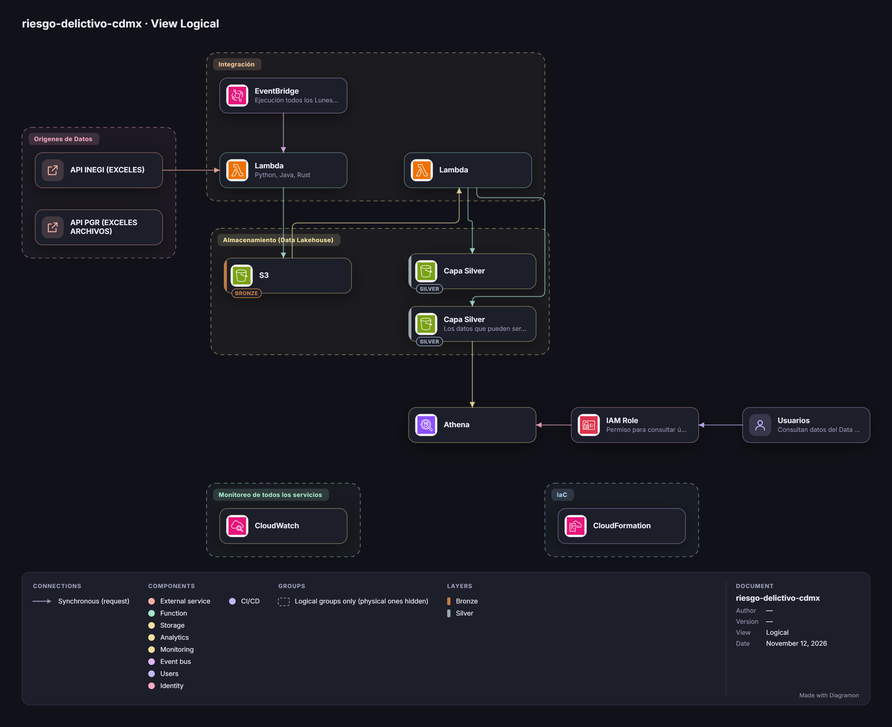

# Riesgo delictivo en la CDMX

Somos **Data Bloom**, un equipo de cinco estudiantes de Ingeniería en Computación. Este repositorio es parte de nuestro proyecto para **SAFEZONE MÉXICO**, el cliente ficticio de la actividad. La idea es tomar datos abiertos de delitos en la Ciudad de México, limpiarlos y dejar un resumen por alcaldía y mes que se pueda consultar desde AWS.

Por ahora estamos trabajando en una **primera versión funcional**. El cálculo usa denuncias históricas; no sirve para predecir delitos ni para decir si una zona es segura. En el `docs/consultoria/sow.md` dejamos los objetivos del proyecto completo, que van más allá de esta entrega.

## Qué hicimos para esta versión

- Tres funciones AWS Lambda en Python: ingesta, limpieza e indicadores.
- Almacenamiento privado en Amazon S3 con capas **bronze**, **silver** y **gold**.
- Ejecución de silver al recibir un CSV en bronze y de gold al recibir el CSV limpio.
- Programación con EventBridge Scheduler, que dejamos **desactivada al principio**.
- Una base y una tabla en Glue Data Catalog para consultar los resultados con Athena.
- Un archivo de AWS SAM / CloudFormation para crear los servicios sin tener que configurarlos uno por uno.

## Cómo funciona



Este es el diagrama que hicimos para la propuesta completa. Todavía muestra las fuentes INEGI/PGR y dos capas silver. En nuestra primera versión vamos a empezar con datos de la FGJ, una sola capa silver y una capa gold para los indicadores; por eso algunos detalles de la imagen son parte del plan original y no de lo que ya tenemos programado.

Para empezar elegimos los datos abiertos de carpetas de investigación de la **FGJ de la CDMX**. Todavía tenemos que comprobar qué enlace de descarga conviene usar, así que la URL se configura cuando desplegamos el proyecto. Mientras tanto podemos subir un CSV pequeño de prueba a bronze. La integración con INEGI y otras fuentes quedará para una siguiente versión.

## Qué guardamos en cada capa

| Capa | Ruta S3 | Contenido |
| --- | --- | --- |
| Bronze | `bronze/fgj/<sha256>.csv` | Archivo de origen sin alterar, con nombre basado en su hash. |
| Silver | `silver/datos/delitos_limpios.csv` | Registros con fecha, alcaldía y categoría normalizadas. |
| Reportes | `silver/reportes/<hash>.json` | Conteos de entradas, aceptadas y descartadas. |
| Gold | `gold/indicadores/indicadores.csv` | Conteos y puntajes por alcaldía y mes; versión metodológica y limitaciones. |

Decidimos trabajar por **alcaldía y mes** porque es más fácil comprobar los resultados que si empezamos directamente por colonia. Para hacer una primera comparación usamos estos pesos de ejemplo: homicidio=5, robo=3, lesiones=2 y otros=1. Con eso mostramos niveles **BAJO**, **MEDIO** o **ALTO** dentro de los datos cargados. Si todos los puntajes son iguales, aparece **SIN DIFERENCIA SUFICIENTE**. Estos pesos no están validados como una fórmula real de riesgo y todavía no ajustamos por población. Explicamos la decisión en `docs/adr/`.

Para no guardar dos veces el mismo archivo, la Lambda de ingesta calcula un hash SHA-256. En bronze conservamos el original; en silver y gold dejamos un archivo con nombre fijo que se actualiza cuando entra otro lote. El historial de resultados procesados es algo que todavía nos falta agregar.

## Estructura

```text
src/
  ingesta/handler.py        Descarga CSV en bronze
  silver/handler.py         Limpieza y reporte de calidad
  gold/handler.py           Agregación e indicador explicable
infra/template.yaml         Servicios de AWS en un solo archivo
sql/consultas.sql           Consultas de ejemplo en Athena
tests/                      Pruebas que podemos ejecutar en nuestra computadora
docs/adr/                   Por qué elegimos alcaldía/mes y Lambda
docs/consultoria/           RFP, SOW y diagrama original del equipo
docs/legacy/                Primeros ADR y plantillas que conservamos como referencia
```

## 1. Probar el código en nuestra computadora

Desde la carpeta principal del repositorio ejecutamos esto con Python 3.13. No se necesita una cuenta de AWS para estas pruebas:

```bash
python -m unittest discover -s tests -v
```

Las Lambdas usan `boto3`, que viene en el entorno administrado de Python de AWS. El archivo `tests/fixtures/muestra_fgj.csv` tiene **datos inventados para las pruebas**, no son cifras reales de delitos.

## 2. Subirlo a AWS

Podemos hacerlo desde **AWS CloudShell**, donde tenemos las herramientas para ejecutar los comandos. Antes de empezar hay que elegir la región, revisar los permisos de la cuenta y configurar una alerta de gastos. AWS puede cobrar por algunos servicios aunque hagamos pocas pruebas.

```bash
git clone --branch MVP_AWS https://github.com/Cvsssss/riesgo-delictivo-cdmx.git
cd riesgo-delictivo-cdmx
sam build --template-file infra/template.yaml
sam deploy --guided --template-file .aws-sam/build/template.yaml
```

Cuando el comando nos pida opciones, autorizamos los roles IAM que necesita el proyecto. Por ahora dejamos estos valores:

- `SourceUrl`: **vacío** (todavía no activamos una descarga real).
- `ScheduleState`: **DISABLED**.
- `Environment`: `dev`.

**Primera prueba:** subimos el CSV de ejemplo. Donde dice `NOMBRE_DEL_BUCKET` ponemos el nombre que AWS nos muestra al terminar el despliegue (`DataBucketName`):

```bash
aws s3 cp tests/fixtures/muestra_fgj.csv s3://NOMBRE_DEL_BUCKET/bronze/fgj/muestra.csv
```

Al subirlo, S3 debe ejecutar silver y luego gold. Revisamos en CloudWatch si hubo errores y comprobamos que aparezcan los archivos de salida. Después podemos probar las consultas de `sql/consultas.sql` en Athena. Ya que eso funcione, repetiremos la prueba con un CSV oficial pequeño que tenga los campos `fecha_hecho`, `alcaldia_hecho` y `categoria_delito`. Cuando unamos la rama a `main`, ya no hará falta usar `--branch MVP_AWS` para clonar.

**Para dejarlo automático:** primero tenemos que revisar la URL del CSV oficial y cuánto pesa. Cuando funcione, actualizamos `SourceUrl` y cambiamos `ScheduleState` a `ENABLED`. El horario que dejamos es diario a las 9:00 a. m. de Ciudad de México.

Como somos cinco, acordamos que **una persona se encargue del despliegue** y los demás trabajemos en el repositorio y las pruebas. Así no necesitamos compartir contraseñas o claves de AWS.

## 3. Comprobar que funcionó

1. Revisar que el CSV original exista en `bronze/` y que `silver/datos/delitos_limpios.csv` se haya generado.
2. Inspeccionar el reporte JSON de calidad; confirmar descartes y encabezados del CSV.
3. Revisar `gold/indicadores/indicadores.csv`; verificar que la suma por grupo concuerde con silver.
4. Usar Athena con la base `riesgo_cdmx_dev`, tabla `indicadores` y el workgroup del stack.
5. Probar que cargar de nuevo el mismo archivo no produzca duplicados en los resultados.

## Lo que todavía nos falta

- Calcular tasas usando población y revisar mejor la fórmula del indicador.
- Aceptar más formatos de archivos, además de las columnas CSV que ya contemplamos.
- Guardar un histórico de resultados de gold por cada lote.
- Hacer la primera prueba completa en AWS; por ahora solo probamos la lógica localmente.
- Medir cuánto tardan las Lambdas, cuánta memoria usan y cuánto cuesta una ejecución real.

Licencia del repositorio: [GPL-3.0](LICENSE).
