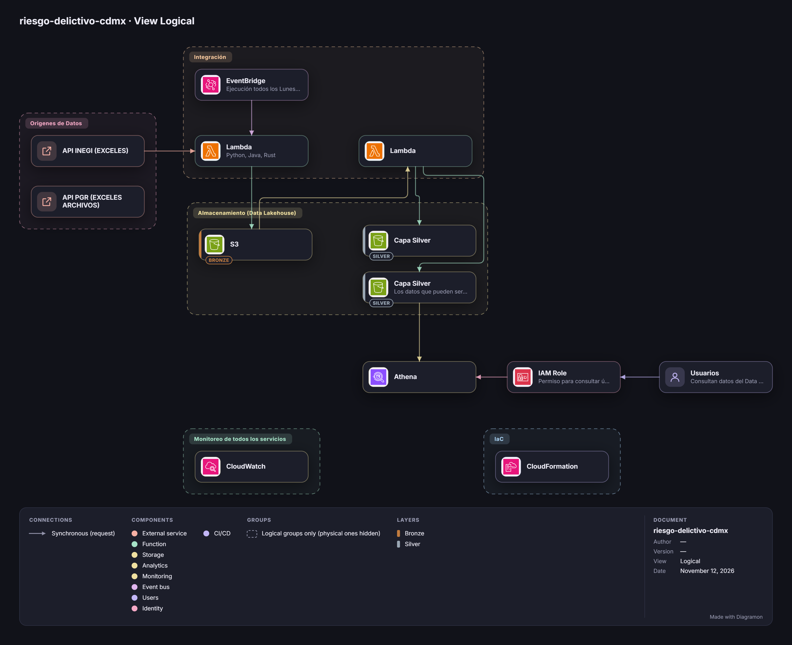

# riesgo-delictivo-cdmx

Pipeline de datos en AWS que toma archivos de INEGI y PGR sobre delitos en la Ciudad de México, los transforma y calcula un nivel de riesgo delictivo por zona y mes.

Proyecto del equipo **Data Bloom** para un cliente simulado, **SAFEZONE MÉXICO**, una empresa que elabora mapas de riesgo.



## Qué problema resuelve

Los datos públicos de delitos llegan en archivos Excel, con errores de captura (colonias mal escritas, ubicaciones vacías) y se actualizan sin aviso. Quien hace mapas de riesgo tiene que descargarlos, limpiarlos y recalcularlos a mano cada vez.

Este proyecto automatiza ese trabajo: cada lunes a las 9:00 am toma los archivos de los orígenes, los guarda sin modificar, los transforma y calcula el riesgo. Los resultados quedan listos para que los usuarios los consulten con SQL en Athena.

## Qué pregunta contesta

> ¿Qué nivel de riesgo delictivo (bajo, medio o alto) tiene cada colonia o alcaldía de la CDMX en cada mes, con datos abiertos actualizados y trazables?

La granularidad final (zona y periodo) se registra en un ADR dentro de `docs/adr/`.

## Cómo funciona

El diagrama muestra el flujo completo. Los componentes, en el orden en que viaja el dato:

| Componente | Qué hace |
|---|---|
| **Orígenes de datos** | API INEGI (archivos Excel) y API PGR (archivos Excel). |
| **EventBridge** | Programa la ejecución todos los lunes a las 9:00 am y lanza la primera Lambda. |
| **Primera Lambda** (Python, Java, Rust) | Toma los archivos de los orígenes y los guarda en bronze. |
| **S3 · bronze** | El dato original, sin modificar. Se puede recalcular todo desde aquí. |
| **Segunda Lambda** | Lee bronze, transforma y valida los datos, y escribe en las dos Capas Silver. |
| **Capa Silver** y **Capa Silver de datos consultables** | Las dos capas silver del Data Lakehouse. La segunda contiene los datos que pueden consultar los usuarios. |
| **Athena** | Consulta con SQL la Capa Silver de datos consultables. |
| **IAM Role** | Da a los usuarios permiso para consultar únicamente Athena. |
| **Usuarios** | Consultan los datos del Data Lake a través de ese rol. |
| **CloudWatch** | Monitoreo de todos los servicios. |
| **CloudFormation** | Define toda la infraestructura como código. |

Decisiones de diseño:

- Cada lote tiene un identificador y cada registro un hash; un reintento reescribe el lote completo y descarta las huellas repetidas.
- Conteo de delitos ponderado por tipo, dividido entre la población, por colonia o alcaldía y mes, convertido en nivel bajo, medio o alto con umbrales configurables. Es una etapa separada para cambiarlo sin tocar la ingesta.
- El volumen por corrida es pequeño. El ADR correspondiente documenta los números y el umbral en que se cambiaría a Glue.
- Los usuarios solo pueden consultar Athena; no tienen acceso a otros servicios.

## Fuentes de datos

- **API INEGI:** archivos Excel.
- **API PGR:** archivos Excel.

Antes de depender de ellas se confirma, para cada origen, que siga publicado, su frecuencia real de actualización, su licencia de uso, el formato de sus archivos y los campos disponibles.

## Estructura del repositorio

```
.
├── docs/
│   ├── consultoria/        # rfp.md, sow.md y el diagrama de arquitectura
│   └── adr/                # decisiones técnicas (en construcción)
├── src/                    # una carpeta por Lambda (en construcción)
├── infra/
│   └── template.yaml       # plantilla de CloudFormation (en construcción)
├── tests/                  # pruebas de la limpieza y del cálculo (en construcción)
├── LICENSE
└── README.md
```

## Cómo desplegar

> Estos pasos aplican cuando exista `infra/template.yaml`. Todo se crea desde la plantilla; nada se crea a clics.

**Requisitos:** una cuenta de AWS y acceso a la consola.

1. En **AWS Budgets**, crea un presupuesto de 1 USD con alerta por correo, antes de crear cualquier recurso.
2. Entra a **CloudFormation** → **Create stack** → **With new resources** y sube `infra/template.yaml`.
3. Completa los parámetros que pida la plantilla y crea el stack.
4. Espera a que el estado sea `CREATE_COMPLETE`.
5. En **Lambda**, abre la primera función y ejecútala con una prueba manual. Verifica que aparezcan archivos en bronze y, después de la segunda Lambda, datos en las Capas Silver.
6. Ejecútala una segunda vez y confirma que el conteo de registros no cambia (no hay duplicados).
7. Con un usuario que tenga el **IAM Role** de consulta, entra a **Athena** y consulta la Capa Silver de datos consultables.
8. En **EventBridge**, confirma que la regla esté programada para los lunes a las 9:00 am.

Para borrar todo: vacía los buckets de S3 y elimina el stack desde CloudFormation.

## Resultados

_Pendiente: se agregará cuando el pipeline corra de punta a punta._ Incluirá una captura de una consulta en Athena sobre la Capa Silver de datos consultables y la bitácora de ejecuciones en CloudWatch.

Cada indicador consultable llevará nivel de riesgo, puntaje, fecha de actualización, versión de la metodología y nota de limitaciones.

## Limitaciones

- Los registros oficiales no incluyen los delitos que no se denuncian (cifra negra).
- Las zonas con más denuncias o más cobertura pueden parecer más riesgosas; las zonas con pocos casos se marcan como "sin información suficiente" en lugar de calificarse.
- El resultado es un nivel de riesgo histórico agregado por zona y periodo. **No** es una predicción de delitos ni identifica personas.

## Estado del proyecto

- [x] RFP y SOW
- [x] Diagrama de arquitectura
- [ ] ADR: Lambda contra Glue
- [ ] ADR: granularidad del cálculo
- [ ] Primera Lambda (ingesta hacia bronze), sin duplicados al reintentar
- [ ] Plantilla de CloudFormation con EventBridge
- [ ] Segunda Lambda (transformación hacia las Capas Silver)
- [ ] IAM Role de solo consulta en Athena
- [ ] Pruebas
- [ ] Resultados y capturas en este README

## Documentación

- [RFP](docs/consultoria/rfp.md): necesidades del cliente.
- [SOW](docs/consultoria/sow.md): alcance, entregables, calendario y presupuesto.

## Equipo

Data Bloom: Amir Cuevas Quintana, Uriel Ivan Guerrero Lopez, Axel Alejandro Quintos Delgadillo, Aaron Rodrigo Leon Pérez y Eduardo Antonio Estrada Luna.

## Licencia

GPL-3.0. Consulta el archivo [LICENSE](LICENSE).
